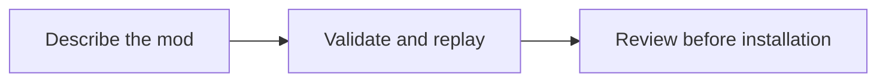

# Local code and diagram preview

Source0.2.0-dev.5 adds Local preview inside the plugin-owned dashboard. The
installed0.2.0-dev.4 snapshot does not contain it. It needs a normal reviewed
update/restart and actual-host acceptance; simulated DOM tests are separate.

Choose a format, paste source and click Render locally. Highlighted JSON validates
JSON syntax and marks keys, strings, numbers and literals. Plain code displays
any language literally, with control/bidirectional formatting characters made
visible. It does not execute code, supply a language server or replace native
transcript/code rendering. Source is limited to4,096 characters.

The original flowchart renderer accepts a **restricted Mermaid-compatible subset**,
not the Mermaid library or its complete language/layout. The primary
[Mermaid flowchart documentation](https://mermaid.js.org/syntax/flowchart.html)
was retrieved2026-10-23, version12.2.0; basic direction/node/edge sections guided
the supported notation. No Mermaid implementation code/dependency was copied.

Use one statement per line. The first line must be `flowchart` or `graph` plus
one direction: `TD`, `TB`, `LR`, `RL` or `BT`. Subsequent lines may contain:

- A bare node identifier such as `A`.
- A rectangular node with a quoted label, such as `A["Review"]`.
- One directed edge with spaces, such as `A --> B`.

Identifiers start with an ASCII letter, followed by at most31 ASCII letters,
digits or underscores; lowercase `end` is refused. Labels are1–80 characters,
without embedded quotes/brackets or control/bidirectional format characters.
Unicode and markup-looking text are literal table text, never HTML. Only one
label declaration per node is accepted. References may precede declarations.
Bounds are16 nodes,24 edges,64 lines and4,096 characters. Self edges are refused.

The graphic places nodes in declaration order in one row/column; it does not
implement Mermaid's automatic graph layout. Node identifiers appear in the
graphic, shortened when necessary. Complete labels and every directed edge are
in the accompanying tables. Crossing/repeated edges can overlap. The tables are
the complete accessible representation. Unsupported syntax yields an explanation
and escaped source, never a partial graph. Directives, HTML interpretation, links,
scripts, styling, subgraphs, other shapes/diagram types and chained/labeled edges
are unavailable. Inspect source in Plain code or use a separately reviewed local
Mermaid tool for the full language; that is a different component.

Rendering makes no MCP/tool/model/network call, file read/write or persistent
storage. Pasted source remains in the panel's memory until Clear or teardown;
switching views keeps it. Clear source and preview removes both. The host owns
the webview and its lifecycle, so this is not a secrecy boundary against the host
or hostile same-user code. No claim is made about OS memory erasure. Existing
project/export read grants, logging and host permissions are unchanged.

The server bundles only two fixed trusted package assets into one offline HTML
resource. UI/server cannot choose asset paths from a project/settings/tool call.
SVG uses fixed tags/numeric geometry and textContent, no user attributes, HTML,
links, marker URLs or remote assets. JSON tokens become fixed-class text spans.
Changing these package assets requires the usual reviewed update/trust workflow.
